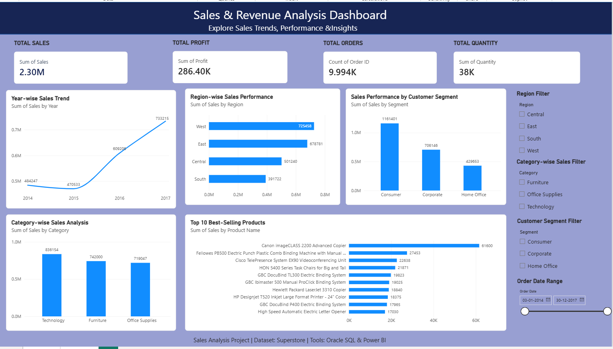

Sales & Revenue Analysis – Superstore

Project Overview

This project focuses on analyzing sales, revenue, profit, customer purchasing behaviour, and product performance using the Superstore dataset.

The objective is to identify business trends and generate meaningful insights to support data-driven decision-making.

Dataset Information

* Dataset: Superstore
* Total Records: 9,994
* Total Columns: 21

Tools & Technologies

* Oracle SQL XE 11g
* SQL
* Microsoft Power BI
* Microsoft Excel
* Visual Studio Code

Project Workflow

1. Dataset exploration and verification
2. Data analysis using SQL queries
3. Sales and profit analysis
4. Category and sub-category analysis
5. Customer and regional analysis
6. Monthly sales trend analysis
7. Power BI dashboard development

Key Analysis Performed

* Total sales and profit
* Total orders and quantity sold
* Sales by category and sub-category
* Sales by region and state
* Top 10 customers by sales
* Top 10 best-selling products
* Monthly sales trends
* Loss-making products
* Average discount by category

Project Files

* Sales_Analysis_Clean.sql
* Sales_Analysis_Queries.sql
* SQL_Verification.sql
* Sales_Analysis_Summary.txt
* Sales_Revenue_Analysis_Dashboard.pbix

Dashboard

Interactive Power BI dashboard for visualizing sales, revenue, profitability, and business performance.

Objective

To demonstrate practical SQL querying, data analysis, and business intelligence skills through a real-world dataset.

## Power BI Dashboard Preview

